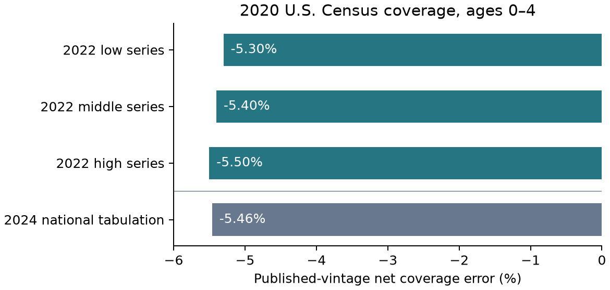

# Completed external diagnostic design

Before downloading the workbook, the diagnostic was limited to the published national ages 0–4, both-sexes row. The goal is to reconstruct net coverage error from the published Census count and each of the three Demographic Analysis (DA) benchmark series. Use the March 2022 release's Table 3 and retain every series. Compare recomputed rates with official displayed precision. Benchmark spread is descriptive sensitivity. These three model variants are not independent observations or a confidence set. The PES estimate from its published age table is contextual, with a different target universe. Do not fit a model, choose a favorable benchmark, identify the gross omitted mass from net error, or apply GENEVRA's synthetic thresholds to Census data.

The cohort and published summary were known from agency documentation before workbook download. This is a retrospective arithmetic check on external data, not a prospective validation, test of superiority, or external peer review. The frozen future protocol is separate.

**Source correction before calculation.** Inspection showed that March 2022 Table 3 contains only net-error percentages, without denominator counts. Preserve those published rates as a three-series sensitivity display. Add the U.S. row of the separate April 2024 state table for a matched-count arithmetic reconstruction at its own vintage. Do not substitute the 2024 count into the 2022 rates or interpret any differences as time effects. Record source hashes and the workbook cells actually used.

The April 2024 state workbook contains state rows and no U.S. row. It was screened and excluded. The April 2024 agency release's national HTML table supplies the matched U.S. numerator and denominator. This is a source substitution for the same national age group, with both corrections disclosed. The March 2022 percentages are reported exactly as published, since those inputs do not permit reconstructing their raw counts.

## Reconstructed observations

| Release and reference | Published net coverage error |
|---|---:|
| March 2022 DA low series | −5.3% |
| March 2022 DA middle series | −5.4% |
| March 2022 DA high series | −5.5% |
| April 2024 DA national tabulation | −5.46% |

The 2022 spread is 0.2 percentage points. In the 2024 release, the Census counted 18,400,235 children against a DA estimate of 19,462,879. The difference is −1,062,644 and dividing by the DA estimate gives −5.459850%. These values are source estimates and a reconstruction of net error. They do not count individually missed children or establish an upper bound on shared omissions.

For context, the March 2022 PES reported −2.79% with standard error 0.64 percentage points for the household ages 0–4 domain. The Bureau explicitly distinguishes the PES universe from DA, including group quarters and remote Alaska. DA's three model series and the PES standard error are different uncertainty objects. This exercise makes no significance or causal comparison between them. [National DA table](https://www.census.gov/data/tables/2020/demo/popest/2020-demographic-analysis-tables.html) · [April 2024 counts](https://www.census.gov/newsroom/press-releases/2024/undercounts-overcounts-children-2020-census.html) · [PES age table](https://www2.census.gov/programs-surveys/decennial/coverage-measurement/pes/national-census-coverage-estimates-by-demographic-characteristics.pdf) · [Coverage universes](https://www.census.gov/newsroom/blogs/random-samplings/2022/03/upcoming-2020-census-coverage-estimates.html)

